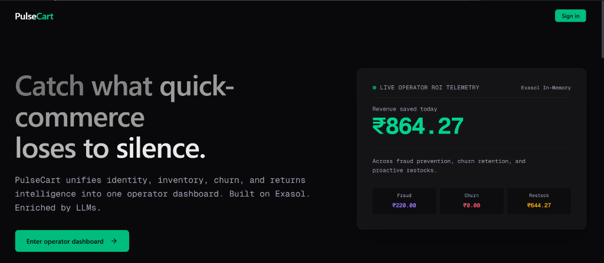

# PulseCart

## Problem Statement

Quick-commerce operators in India — Blinkit, Zepto, Swiggy Instamart, and the rest — promise 10-to-30-minute delivery, but they lose **8 to 12 percent of revenue** to four silent killers that hide inside their own data:

- **Fragmented customer identity:** The same shopper exists as four different identities across four different systems.
- **Reactive inventory management:** Stockouts are discovered only after an order fails.
- **Unread churn signals:** Churn signals sit unread inside free-text support tickets.
- **Misclassified returns:** Returns are tracked as logistics events, not as profit-eroding behaviors tied to specific customers.


**Real-time customer intelligence and margin protection for quick commerce**

PulseCart is an analytical platform for quick-commerce operations. It combines Exasol SQL analytics, a FastAPI service layer, and Groq-hosted language models to identify promotion abuse, forecast inventory risks, prioritize customer churn, and analyze return-related margin losses across dense urban dark-store networks.



---

## Problem Statement

Quick-commerce operators in India — Blinkit, Zepto, Swiggy Instamart, and the rest — promise 10-to-30-minute delivery, but they lose **8 to 12 percent of revenue** to four silent killers that hide inside their own data:

- **Fragmented customer identity:** The same shopper exists as four different identities across four different systems.
- **Reactive inventory management:** Stockouts are discovered only after an order fails.
- **Unread churn signals:** Churn signals sit unread inside free-text support tickets.
- **Misclassified returns:** Returns are tracked as logistics events, not as profit-eroding behaviors tied to specific customers.

---

## Overview

Quick-commerce businesses operate with razor-thin margins (2–5%) and face operational risks across customer identity, inventory, customer support, and serial returns. PulseCart brings these signals into a single unified platform backed by an Exasol analytical columnar database.

The system is organized around five operational modules situated in Bengaluru (India's quick-commerce capital), managing dark stores across Koramangala, Indiranagar, HSR Layout, and Whitefield:

- **Identity resolution and promotion abuse:** Links customer golden identities across addresses and evaluates address similarity to flag suspicious discount redemptions and burner accounts.
- **Inventory risk detection:** Combines store inventory with 6-hour machine learning demand forecasts to identify dark-store SKUs at critical risk of stockout.
- **Customer churn and retention:** Uses LLM-based ticket classification (Groq LPU) to assess urgency and sentiment, prioritize churn risk, and dispatch automated retention credits.
- **Returns and margin analysis:** Identifies customers with serial return patterns and detects margin-negative "toxic SKUs" attributable to quality or cold-chain failures.
- **Operational monitoring & Command Center:** Aggregates real-time ROI indicators (in ₹ / INR), ingestion pipeline telemetry across 5 streaming sources, service health, and operational alerts.

---

## Architecture

```text
┌────────────────────────────────────────────────────────────────────────┐
│                      QUICK-COMMERCE SOURCE SYSTEMS                     │
│    Order App · Customer identities · Inventory · Support · Returns     │
└───────────────────────────────────┬────────────────────────────────────┘
                                    ▼
┌────────────────────────────────────────────────────────────────────────┐
│                       EXASOL ANALYTICAL DATABASE                       │
│    Operational records · Columnar in-memory views · Customer 360       │
└───────────────────────────────────┬────────────────────────────────────┘
                                    │ PyExasol over WebSocket (:8563)
                                    ▼
┌────────────────────────────────────────────────────────────────────────┐
│                         FASTAPI SERVICE LAYER                          │
│            REST endpoints · Workflows · Telemetry & Data access        │
└───────────────────┬────────────────────────────────┬───────────────────┘
                    │                                │
                    │ Ticket analysis                │ REST / JSON
                    ▼                                ▼
┌──────────────────────────────────────┐  ┌──────────────────────────────┐
│          GROQ INFERENCE API          │  │      PULSECART FRONTEND      │
│  Primary · Fallback · Heuristics     │  │  Next.js Operator Dashboard  │
└──────────────────────────────────────┘  └──────────────────────────────┘
```

Exasol provides the in-memory columnar compute layer. FastAPI exposes operational workflows through typed HTTP endpoints, while Groq handles high-throughput LLM inference for support-ticket analysis. The service connects via PyExasol over native WebSockets.

---

## Engineering Techniques

- **Analytical views and customer data synthesis:** SQL views (`VW_CUSTOMER_GOLDEN`, `VW_STOCKOUT_WARNINGS`, `VW_CHURN_RISK`, `VW_RETURNS_ABUSERS`, `MV_CUSTOMER_360`) consolidate identity, inventory, churn, and returns signals directly in Exasol.
- **Fuzzy address matching:** Python's `difflib.SequenceMatcher` provides token-level similarity scoring for cross-customer address comparisons.
- **REST API design:** FastAPI provides typed Pydantic request handling and automatically generated OpenAPI documentation at `/docs`.
- **Resilient inference:** A primary LLM (`openai/gpt-oss-20b`), a secondary model (`qwen/qwen3.8-27b`), and a rule-based heuristic classifier provide successive fallback paths when inference is unavailable or rate-limited.
- **Database-side computation:** An Exasol Python scalar UDF illustrates how similarity computations can be pushed into Exasol's MPP cluster in deployments with the required language container.
- **Operational simulation:** A simulation script generates orders, support inquiries, promotion decisions, and streaming pipeline telemetry for live operator demonstrations.

---

## Technologies

| Technology | Role |
|---|---|
| [Python 3.11](https://www.python.org/) | Backend implementation and business logic |
| [FastAPI](https://fastapi.tiangolo.com/) | REST API service layer and request handling |
| [Exasol Personal Edition](https://github.com/exasol/exasol-personal) | In-memory columnar analytical database and SQL compute |
| [PyExasol](https://github.com/exasol/pyexasol) | Python-to-Exasol native WebSocket connectivity |
| [Groq](https://console.groq.com/docs/overview) | High-speed hosted LLM inference (LPU) |
| [`difflib`](https://docs.python.org/3/library/difflib.html) | Fuzzy address similarity and entity matching |
| [Next.js](https://nextjs.org/) / [React](https://react.dev/) | Operator dashboard web application |
| [Tailwind CSS](https://tailwindcss.com/) | Dark-mode design system with data-dense typography |
| [Uvicorn](https://www.uvicorn.org/) | High-performance ASGI server for FastAPI |

---

## Project Structure

```text
PulseCart/
├── pulsecart-frontend/     # Next.js B2B operator dashboard
│   ├── app/                # App router (Landing, Login, Dashboard routes)
│   ├── components/         # Reusable UI cards, tables, pipeline bars
│   └── lib/                # API client, types, and INR currency formatting
├── udf/
│   └── fuzzy_match.sql     # Exasol Python UDF definition for in-database matching
├── scripts/
│   ├── simulate.py         # Live quick-commerce activity simulator
│   └── run_acceptance.py   # Automated 13-point end-to-end acceptance suite
├── database.py             # PyExasol connection management & credential resolution
├── main.py                 # FastAPI application and 20+ operational REST endpoints
├── llm_service.py          # Groq LLM ticket analysis with resilient 3-tier fallback
├── init.sql                # Exasol DDL schema and Bengaluru seed data
├── exasol-views.sql        # Analytical views and Customer 360 materialization
├── requirements.txt        # Python dependency manifest
├── .env.example            # Environment template
└── LICENSE                 # MIT License
```

---

## API Surface

| Route group | Method | Purpose |
|---|---|---|
| `GET /health` | GET | Database connectivity check and Exasol status |
| `POST /api/v1/checkout` | POST | Real-time promo abuse check via fuzzy address matching |
| `GET /api/v1/identity/customer/{id}` | GET | Customer Golden Record, linked addresses, and orders |
| `GET /api/v1/fraud/log` | GET | Log of blocked promotion abuse events |
| `/api/v1/inventory/*` | GET/POST | Dark store health, 6h stockout warnings, and reorder dispatch |
| `/api/v1/tickets/*` | GET/POST | Support queue, LLM sentiment/urgency, and retention offers |
| `/api/v1/returns/*` | GET | Return abusers leaderboard, toxic SKUs, and margin impact |
| `/api/v1/overview/*` | GET | Consolidated ROI (in ₹), pipeline health, and alerts feed |

Interactive API documentation and schema definitions are accessible at `http://localhost:8000/docs`.

---

## Getting Started

### 1. Prerequisites
- Python 3.10+
- Node.js 18+ (for frontend)
- Exasol Personal Edition or Docker container running on `127.0.0.1:8563`
- Groq Cloud API key

### 2. Backend Setup
```bash
# Clone and enter directory
cp .env.example .env
# Set GROQ_API_KEY in .env

# Install Python packages
pip install -r requirements.txt

# Seed the Exasol database
python -c "
import database
with open('init.sql', 'r', encoding='utf-8') as f:
    sql = f.read()
cleaned = '\n'.join([l for l in sql.splitlines() if not l.strip().startswith('--')])
for s in cleaned.split(';'):
    if s.strip(): database.execute_statement(s)
print('Exasol database initialized!')
"

# Start the FastAPI server
uvicorn main:app --host 0.0.0.0 --port 8000
```

### 3. Frontend Setup
```bash
cd pulsecart-frontend
npm install
npm run dev
```
Open [http://localhost:3000](http://localhost:3000) for the landing page or [http://localhost:3000/dashboard](http://localhost:3000/dashboard) for the Operator Command Center.

### 4. Run Live Simulator
```bash
python scripts/simulate.py
```

---

## Implementation Notes

### Address Matching and Deployment Portability
The local deployment runs fuzzy address matching in Python with `difflib.SequenceMatcher` to prevent setup friction across containerized Exasol instances. The optional Exasol UDF in `udf/fuzzy_match.sql` demonstrates how the same algorithm runs distributed across Exasol cluster nodes when the Python 3 script language container is configured.

### LLM Fallback Strategy
Ticket classification uses `openai/gpt-oss-20b` as the primary low-latency model, `qwen/qwen3.8-27b` as the secondary model, and an offline rule-based heuristic classifier if Groq is unreachable.

### Single-City Quick-Commerce Focus
All 4 dark stores (`STORE-BLR-01` to `STORE-BLR-04`) and customer accounts reside in Bengaluru (Koramangala, Indiranagar, HSR Layout, Whitefield), reflecting realistic 10–15 minute dark store delivery geometry and localized INR (`₹`) financial telemetry.

---

## License

Distributed under the MIT License. See [`LICENSE`](LICENSE).
